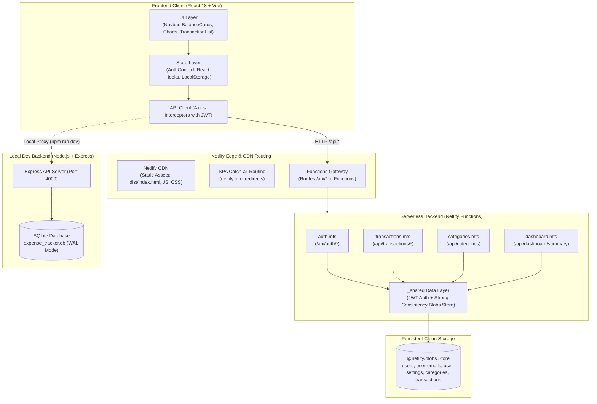
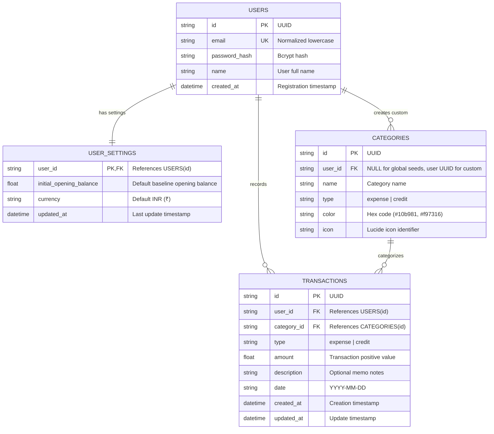
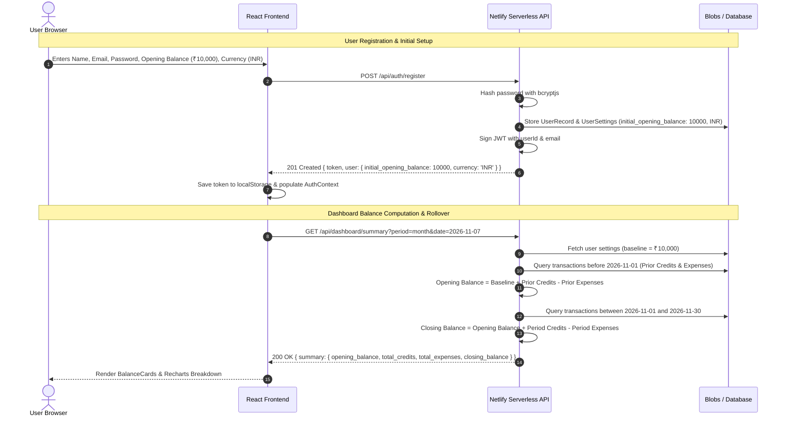

# ExpenseTrack Pro - Full-Stack Financial Management Platform

[](https://app.netlify.com/projects/expense-tracker-ak-a7652b16/deploys)
[](https://github.com/ankit2610ak/Expense-tracker)
[](https://nodejs.org/)
[](LICENSE)

A modern, high-performance full-stack Expense Tracker web application built with **React 18 + Vite + Tailwind CSS**, **Node.js + Express (TypeScript)**, **SQLite**, and **Netlify Serverless Functions with Blobs persistent storage**.

🌐 **Live Production URL**: [https://expense-tracker-ak-a7652b16.netlify.app](https://expense-tracker-ak-a7652b16.netlify.app)  
📦 **GitHub Repository**: [https://github.com/ankit2610ak/Expense-tracker](https://github.com/ankit2610ak/Expense-tracker)

---

## Table of Contents

- [Key Features](#key-features)
- [System Design & Architecture (UML)](#system-design--architecture-uml)
  - [1. System Architecture Flow](#1-system-architecture-flow)
  - [2. Entity-Relationship Diagram (ERD)](#2-entity-relationship-diagram-erd)
  - [3. Authentication & Balance Rollover Sequence](#3-authentication--balance-rollover-sequence)
  - [4. Balance Rollover Formula](#4-balance-rollover-formula)
- [Tech Stack](#tech-stack)
- [Project Structure](#project-structure)
- [Local Development Setup](#local-development-setup)
- [Running Automated Tests](#running-automated-tests)
- [Production Deployment (Netlify)](#production-deployment-netlify)
- [API Reference](#api-reference)
- [Release Notes](#release-notes)

---

## Key Features

- **User Authentication & Data Isolation**:
  - Secure registration & login with password hashing via `bcryptjs` (salt factor 10) and JSON Web Tokens (JWT, 7-day expiry).
  - Private data sandbox: each user only ever accesses their own transactions, categories, and settings.
- **Accurate Opening & Closing Balance Rollover**:
  - Initial opening balance configured on registration or anytime via the Settings modal.
  - Automatic time-period rollover: opening balance accurately aggregates prior inflows and outflows before the selected window.
  - Live closing balance computation: $\text{Closing Balance} = \text{Opening Balance} + \text{Credits} - \text{Expenses}$.
- **Multi-Currency Support**:
  - Default currency: **INR (₹)** with `en-IN` Indian numbering system formatting (lakhs/crores).
  - Instant one-click currency switcher in Navbar for INR, USD, EUR, GBP, CAD, AUD, JPY, and CHF.
- **Transaction Entry & Categorization**:
  - Quick-add modal for **Expense** (cash outflow) or **Credit** (income inflow).
  - 16 pre-seeded default categories with custom color badges and Lucide icons.
  - Ability to create custom user categories dynamically.
- **Interactive Visual Dashboard**:
  - Timeframe toggles: **Weekly** (7-day daily breakdown), **Monthly** (5-week breakdown), **12-Month** (rolling monthly time series), and **All-Time**.
  - Comparison bar charts (Inflows vs. Outflows) and category distribution donut charts via Recharts.
- **Search & Filter Engine**:
  - Instant full-text search across descriptions and categories.
  - Filter by transaction type (*All*, *Expenses*, *Credits*) and specific category.
- **Hybrid Deployment Engine**:
  - Local mode: Express TypeScript server with native SQLite database (`WAL` mode).
  - Cloud serverless mode: Netlify Functions (`.mts`) with resilient `@netlify/blobs` strong-consistency storage.

---

## System Design & Architecture (UML)

### 1. System Architecture Flow



---

### 2. Entity-Relationship Diagram (ERD)



---

### 3. Authentication & Balance Rollover Sequence



---

### 4. Balance Rollover Formula

$$\text{Opening Balance} = \text{Baseline Initial Balance} + \sum_{t < \text{Start Date}} \text{Credits}_t - \sum_{t < \text{Start Date}} \text{Expenses}_t$$

$$\text{Closing Balance} = \text{Opening Balance} + \sum_{\text{Start Date} \le t \le \text{End Date}} \text{Credits}_t - \sum_{\text{Start Date} \le t \le \text{End Date}} \text{Expenses}_t$$

---

## Tech Stack

| Layer | Technology | Purpose |
| :--- | :--- | :--- |
| **Frontend Framework** | React 18, TypeScript, Vite 6 | High-speed client application |
| **Styling & Icons** | Tailwind CSS 3, Lucide React | Modern responsive design & iconography |
| **Data Visualization** | Recharts 2 | Time-series bar charts & category distribution donut charts |
| **HTTP Client** | Axios | Interceptors with automatic Bearer token injection |
| **Cloud Serverless** | Netlify Functions (`.mts`) | Zero-server backend with auto-scaling |
| **Cloud Storage** | `@netlify/blobs` (Strong Consistency) | Cloud key-value document store for user records & transactions |
| **Local Backend** | Node.js, Express, TypeScript | Full-featured local development server |
| **Local Database** | SQLite (`node:sqlite` in WAL mode) | Zero-config relational database for local use |
| **Testing** | Vitest, Supertest | Unit and integration testing across 52 automated tests |

---

## Project Structure

```
Expense tracker/
├── package.json                 # Monorepo root scripts & dev dependencies
├── netlify.toml                 # Netlify build, functions, and SPA redirect rules
├── README.md                    # Comprehensive documentation & architecture UML
├── backend/                     # Local Express + SQLite Backend
│   ├── package.json
│   ├── vitest.config.ts
│   ├── src/
│   │   ├── index.ts             # Express server entry point (port 4000)
│   │   ├── app.ts               # Express middleware & router mounting
│   │   ├── db/
│   │   │   ├── database.ts      # SQLite connection & schema initializer
│   │   │   └── seed.ts          # Default category seeder (16 categories)
│   │   ├── middleware/auth.ts   # JWT authentication verification
│   │   └── routes/              # Express route handlers
│   └── tests/                   # 21 backend unit & integration tests
└── frontend/                    # React 18 + Netlify Functions
    ├── package.json
    ├── vite.config.ts           # Vite bundler with local API proxying
    ├── vitest.config.ts         # Vitest runner for serverless functions
    ├── netlify/
    │   └── functions/
    │       ├── auth.mts         # /api/auth (register, login, me, settings)
    │       ├── transactions.mts # /api/transactions (CRUD & filters)
    │       ├── categories.mts   # /api/categories (seeded & custom)
    │       ├── dashboard.mts    # /api/dashboard/summary (balance analytics)
    │       └── _shared/
    │           ├── auth.ts      # JWT sign, verify, and auth helper
    │           ├── db.ts        # Resilient @netlify/blobs + memory storage adapter
    │           └── seed.ts      # 16 default category definitions
    ├── tests/                   # 31 unit & integration tests for Netlify functions
    │   ├── unit/                # Token & DB store unit tests
    │   └── integration/         # API handler end-to-end integration tests
    └── src/
        ├── App.tsx              # Main dashboard application
        ├── context/             # AuthContext session manager
        ├── services/api.ts      # Axios API service client
        └── components/          # Reusable UI components
```

---

## Local Development Setup

### 1. Prerequisites
- [Node.js](https://nodejs.org/) v20 or higher
- [npm](https://www.npmjs.com/) v10 or higher

### 2. Installation
```bash
# Clone the repository
git clone https://github.com/ankit2610ak/Expense-tracker.git
cd Expense-tracker

# Install all dependencies across root, backend, and frontend
npm run install:all
```

### 3. Run Locally
```bash
npm run dev
```
- **Frontend**: [http://localhost:3000](http://localhost:3000)
- **Backend API**: [http://localhost:4000](http://localhost:4000)

*(The frontend automatically proxies `/api/*` to the backend on port 4000).*

---

## Running Automated Tests

The repository includes **52 automated unit and integration tests** ensuring data integrity, privacy isolation, balance calculations, and API routing.

```bash
# Run all tests (both backend and frontend)
npm test

# Run frontend serverless functions tests (31 tests)
npm run test:frontend

# Run backend Express & SQLite tests (21 tests)
npm run test:backend
```

### Test Coverage Highlights:
- ✅ Password hashing & duplicate email prevention (409 Conflict)
- ✅ JWT verification & unauthorized access protection (401 Unauthorized)
- ✅ Strict multi-user data privacy isolation
- ✅ Rollover balance computation across custom dates and periods
- ✅ 12-month rolling summary (12 monthly chronological data points)
- ✅ Category assignment, filtering, and custom category creation
- ✅ Transaction CRUD operations with transaction total calculations

---

## Production Deployment (Netlify)

The project is pre-configured for continuous deployment via **Netlify Git integration** or the **Netlify CLI**.

### Deploy via Netlify CLI:
```bash
# Deploy to production
npx netlify deploy --prod
```

### Environment Variables:
Set the following under **Netlify Dashboard → Site configuration → Environment variables**:
- `JWT_SECRET`: A secure random secret string for JWT signing.
- `NODE_VERSION`: `20`

---

## API Reference

### Auth Endpoints (`/api/auth`)
| Method | Endpoint | Description | Auth Required |
|:---|:---|:---|:---|
| `POST` | `/api/auth/register` | Register new user with initial opening balance | No |
| `POST` | `/api/auth/login` | Authenticate with email & password, receive JWT | No |
| `GET` | `/api/auth/me` | Fetch authenticated user profile & balance settings | Yes (`Bearer <token>`) |
| `PUT` | `/api/auth/settings` | Update baseline opening balance and preferred currency | Yes (`Bearer <token>`) |

### Transactions Endpoints (`/api/transactions`)
| Method | Endpoint | Description | Auth Required |
|:---|:---|:---|:---|
| `GET` | `/api/transactions` | Query transactions (`type`, `category_id`, `start_date`, `end_date`, `search`) | Yes (`Bearer <token>`) |
| `POST` | `/api/transactions` | Create new expense or credit transaction | Yes (`Bearer <token>`) |
| `PUT` | `/api/transactions/:id` | Update transaction amount, category, date, or note | Yes (`Bearer <token>`) |
| `DELETE` | `/api/transactions/:id` | Delete an existing transaction | Yes (`Bearer <token>`) |

### Categories Endpoints (`/api/categories`)
| Method | Endpoint | Description | Auth Required |
|:---|:---|:---|:---|
| `GET` | `/api/categories` | List 16 default categories and custom user categories | Yes (`Bearer <token>`) |
| `POST` | `/api/categories` | Create custom user category with icon and color | Yes (`Bearer <token>`) |

### Dashboard Analytics (`/api/dashboard`)
| Method | Endpoint | Description | Auth Required |
|:---|:---|:---|:---|
| `GET` | `/api/dashboard/summary` | Get opening/closing balances, period totals, charts, & category breakdowns (`period=week\|month\|year\|all`) | Yes (`Bearer <token>`) |

---

## Release Notes

### v1.1.0 - Production Serverless Release
- **Serverless Architecture**: Added full Netlify Functions backend (`auth.mts`, `transactions.mts`, `categories.mts`, `dashboard.mts`).
- **Resilient Blobs Storage**: Integrated `@netlify/blobs` with strong consistency and in-memory fallback.
- **Initial Opening Balance Fix**: Fixed opening balance persistence so initial balance configured on account creation immediately displays after login.
- **Multi-Currency Support**: Added INR (₹) default with real-time currency selector (USD, EUR, GBP, CAD, AUD, JPY, CHF).
- **12-Month Filter**: Added rolling 12-month analytics view with monthly time series breakdown.
- **Test Automation**: Added 31 unit and integration tests (52 total passing tests).
